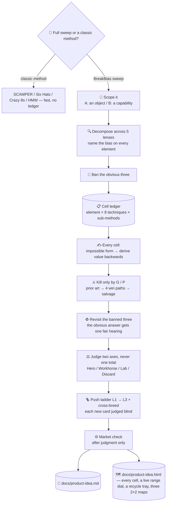

# 💡 superforge-brain — the BreakBias engine

[](https://opensource.org/licenses/MIT)
[](https://claude.com/claude-code)
[](https://github.com/takaoumehara/breakbias-studio)

**English** · [日本語](README.ja.md) · [简体中文](README.zh-CN.md) · [Español](README.es.md) · [한국어](README.ko.md)

> **Stop waiting for a good idea to arrive. Make a machine sweep every combination, and read what survives.**

---

## 🔰 What is this?

About thirty minutes into any brainstorming meeting, someone says "yeah, that one's probably fine." Not because a good idea was found, but because **somebody got tired first**.

BreakBias does not get tired.

It breaks the subject into 20–40 elements and crosses each one with eight techniques and their sub-methods. Every combination is **a cell** with an ID and a status, and the run finishes only when all of them are terminal. Not "I think we covered everything" — *300 of 300 cells complete*.

A person cannot fill a 300-row grid without losing their place. Software can. **That asymmetry is the entire reason this is a skill and not a meeting.**

---

## 📐 Architecture



Nothing is pruned mid-sweep. Deduplication and scoring happen after generation, never during. The method itself is a choice stated up front, not an assumption.

---

## ✨ Features

### 📋 "We covered everything" becomes a number
Element × technique × sub-method is one row in a ledger, and status moves one way only: `todo → generated → survived/killed → developed → judged`. Done means *zero rows left at `todo`*. A skipped cell cannot quietly become a cell that never existed.

### 🔒 Nothing comes in from outside the box (Closed World)
Ideas are assembled only from elements already inside the subject and its immediate boundary. The moment you import something external it stops being non-obvious and becomes an addition anyone could have made. That constraint is what produces a genuinely new arrangement instead of a competitor's feature bolted on.

### ⚖️ "It already exists" is not a reason to kill anything
A cell dies on two codes only — **G** (swap the subject and it still reads fine, so it was never about this system) and **P** (physically impossible). Both are checkable without knowing the market, which is the point: a kill that requires market knowledge is the same poison this engine delays until §8, administered earlier and less visibly.

An idea that already ships somewhere gets tagged, not killed, and then run through four win paths — **delta** (one small change makes it a different experience), **geography** (it exists in one market and not another), **timing** (it was impossible before and is possible now), and **execution** (nobody is doing it well, and you can name the specific flaw). Only an idea that fails all four is killed. Then a **salvage pass** re-reads the killed rows, because a wrongly killed idea never appears in the report — making it the one failure you can never catch by looking at the output.

### 🏪 The supermarket problem, fixed
Scored the old way, "open a supermarket in this town" gets Novelty 1, Wow 1, User Impact 9, Company Impact 8 — total 19, below the cut, deleted. Every town needs one. It reliably makes money. The engine was measuring *distance from the obvious* and calling the result *worth*.

Now the four scores become two axes that are never added together — **Originality** (Novelty + Wow) and **Viability** (User + Company Impact) — and the verdict is a quadrant: **Hero** (unseen and wanted), **Workhorse** (ordinary and reliably needed), **Lab** (brilliant, unfundable today, shelved with the condition that brings it back), **Discard** (the only legitimate one). And because the obvious answer is usually obvious *for a reason*, the banned three get **one revisit** after the sweep, through the same four win paths.

### 🗺️ You see what got cut, not only what survived
`docs/product-idea.html` shows **every generated idea**, killed ones included, each with its kill code and one-line reason — no more being handed only the final three names. An idea killed as prior art shows all four win paths struck through, so you can see that four ways to win were attempted before it was dropped. Three 2×2 maps plot the results spatially: Originality × Viability (the four quadrants, labelled in the plot area itself), Impact × Effort (with the low-hanging-fruit quadrant named), and User Impact × Company Impact.

### 🎚️ Choose how safe the answer is (range dial)
Some days you want something that ships, and other days you are tired of sensible answers. The range dial — `grounded` / `balanced` / `far-out` — splits the final shortlist into three lanes, **Safe** (Workhorse), **Core** (Hero) and **Far** (Lab plus far-out rungs), and decides how many slots each lane gets. It never deletes anything. Lanes are computed from scores, so you can turn the dial in the HTML afterwards and watch the shortlist change without re-running the sweep. If a lane can't fill its quota, the slot stays visibly empty. A gap is a finding, not something to pad.

### 🪜 Push the good ones further (push ladder and cross-breeding)
A cell is one transformation of one element, and good ideas are rarely one step from the obvious. So the top survivors climb a ladder: **L1 grounded** (the 30-day version), **L2 stretch** (one more premise broken), and **L3 far-out**, which may import one outside element or jump ten years but must say *why it is impossible today* and *the first step that is possible today*. Survivors from different techniques and elements are also **cross-bred**. Every rung and hybrid becomes its own card, judged blind, so you can see whether the best idea came from the sweep, the push, or a cross.

### ♻️ Pick discarded ideas back up (recycle)
Every card on the board, killed ones included, has a **pick** checkbox and a push level. Ticked cards collect in a tray that writes the follow-up command, e.g. `/superforge-brain recycle E04-DIV-2 --push far-out`. Paste it back, and the skill continues from `docs/product-idea.ledger.json` without re-running the sweep. Your pick decides what gets developed. The judge still decides how it scores.

### 🧠 A fresh context for every element (why the ideas got better)
By cell 200 of one long conversation, a model is completing its own earlier forms, and everything becomes "a subscription" or "a community". In Claude Code, `workflows/superforge-brain-sweep.js` generates each element batch in its own agent that never sees other elements. Kill checking, card writing, and judging each run in separate agents, and the judge never sees how an idea was reached. Every card must also describe **one concrete scene**, and a card that can only be written in abstract nouns scores low on Wow. Without the workflow runtime, the prose fallback re-anchors per element and keeps a shape-repeat ledger.

### 🔀 BreakBias is a choice, not the only option
Ask once, up front: the full tracked sweep, or a classic method — SCAMPER, Six Thinking Hats, Crazy 8s, How Might We, brainwriting, reverse brainstorming. The heavy engine is for when the idea needs to hold up under scrutiny; a classic method is for a fast, low-stakes first pass. Full menu in `references/classic-methods.md`.

---

## 🔄 Before / After

| | Before | After |
|---|---|---|
| How it ends | When someone got tired | When the ledger has zero `todo` rows |
| Where ideas come from | Whatever surfaced first | Every element × technique × sub-method |
| The obvious answer | Proposed again every time | Banned up front; novelty scored as distance from it |
| When you look at the market | First — and the thinking shrinks | After judgment, so it cannot skew novelty |
| What you get to see | The final three names | Every idea generated, what was killed, and why |
| How you prioritise the survivors | Read every card and guess | Three 2×2 maps — Originality × Viability quadrants, Impact × Effort, User × Company Impact |
| An ordinary idea with real demand | Killed as "already exists" | Tagged, tested against four win paths, kept as a **Workhorse** |
| A brilliant idea that makes no money | Discarded with everything else | Shelved as **Lab**, with the condition that brings it back |
| The three obvious answers | Banned and never seen again | Banned from generation, revisited once before judging |
| Which method runs | BreakBias, assumed | A choice, stated up front — full sweep or a classic method |
| How safe or bold the answer is | Whatever the engine happened to like | Your choice — `grounded` / `balanced` / `far-out`, changeable after the run |
| A decent idea that could go further | Left as written | Pushed up a ladder to grounded, stretch, and far-out, plus cross-bred |
| An idea you disagree was cut | Gone | Tick it in the HTML and paste the recycle command |
| What remains | A chat log | `docs/product-idea.md` + `docs/product-idea.ledger.json` + `docs/product-idea.html` with the ban list and the coverage count |

---

## 🚀 Install & Usage

### 🖥️ Install all fourteen skills (once)

Clone the repository and run the installer. It links every skill into every skills directory it finds on this machine — Claude Code, Codex CLI, Gemini CLI, Antigravity.

```bash
git clone https://github.com/takaoumehara/superforge-skill
cd superforge-skill
./install.sh
```

Full options, single-skill installs, and the claude.ai upload route are in the [suite README](../../README.md).

### ⌨️ Call it

```
/superforge-brain
```

It starts by asking which method: the full BreakBias sweep, or a faster classic method (SCAMPER, Six Hats, Crazy 8s, How Might We — see `references/classic-methods.md`). For a sweep, it then settles whether the subject is an object or a capability (Domain A / B), and explains the resolution dial in plain terms before asking — `quick` (~80 cells, one pass on the highest-potential elements), `standard` (~300, every element × every technique once), or `exhaustive` (900+, plus unblocking passes wherever a shape repeats). In the same breath it asks the range dial: `grounded`, `balanced` (default), or `far-out`. If `docs/brief.md` exists it reads that instead of re-asking.

In Claude Code, say *"use a workflow"* or run `/superforge-brain-sweep` for the fresh-context version. After a run:

```
/superforge-brain recycle E04-DIV-2 E11-REV-1 --push far-out
/superforge-brain push E02-SUB-1 --to far-out
/superforge-brain cross E03-REV-1 E04-AD-1
/superforge-brain dial grounded
```

---

## 🧬 Relationship to SIT

BreakBias stands on two principles from **SIT (Systematic Inventive Thinking)**:

- **Closed World** — never import an element from outside the box
- **Function Follows Form** — build the impossible shape first, derive the value backwards

Those are inherited. Here is what BreakBias adds.

| | SIT | BreakBias |
|---|---|---|
| Techniques | 5 | **8** (adds Reverse / Shift / Repurpose) |
| Bias | not handled explicitly | **named on every element** (functional / structural / relational) |
| Clichés | — | **three banned up front**, and novelty is scored as distance from them |
| Exhaustiveness | depends on human stamina | **a cell ledger a machine verifies** — any `todo` left means unfinished |
| Selection | — | **G / P kill codes only**, four win paths for prior art, a salvage pass, and a revisit of the banned three |
| Scoring | — | **a judge in a separate context**, never shown the rationale |
| Market | out of scope | **red / gray / white plus an entry verdict, after judgment only** |

SIT is a method for people in a room. BreakBias rebuilds it into something **a machine can sweep exhaustively, and prove that it did**.

Implementation and real run logs: [takaoumehara/breakbias-studio](https://github.com/takaoumehara/breakbias-studio)

---

## 📄 License

MIT — see [LICENSE](../../LICENSE). The skill body is in [SKILL.md](SKILL.md); the sub-methods, kill tests, judge protocol, market rubric, and direction filter are in [references/ideation-tools.md](references/ideation-tools.md); the quadrants, win paths, and ban-list revisit are in [references/value-classification.md](references/value-classification.md); checking the result against real people is in [references/talk-to-users.md](references/talk-to-users.md); the classic-method menu (SCAMPER, Six Hats, Crazy 8s, and more) is in [references/classic-methods.md](references/classic-methods.md); the `docs/product-idea.html` spec — every idea visualised, plus the quadrant, Impact×Effort, and User×Company Impact maps — is in [references/idea-map-output.md](references/idea-map-output.md), with a working reference page in [assets/idea-map.html](assets/idea-map.html) (open it in a browser — it ships with demo data); the range dial, push ladder, cross-breeding, and recycle commands are in [references/amplify-and-recycle.md](references/amplify-and-recycle.md). Suite overview: [superforge-skill](../../README.md).
